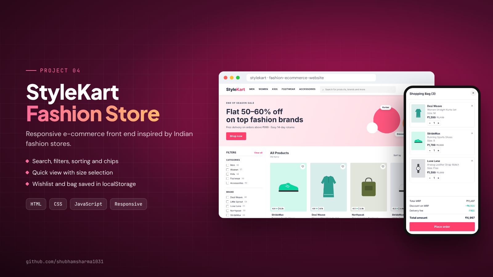
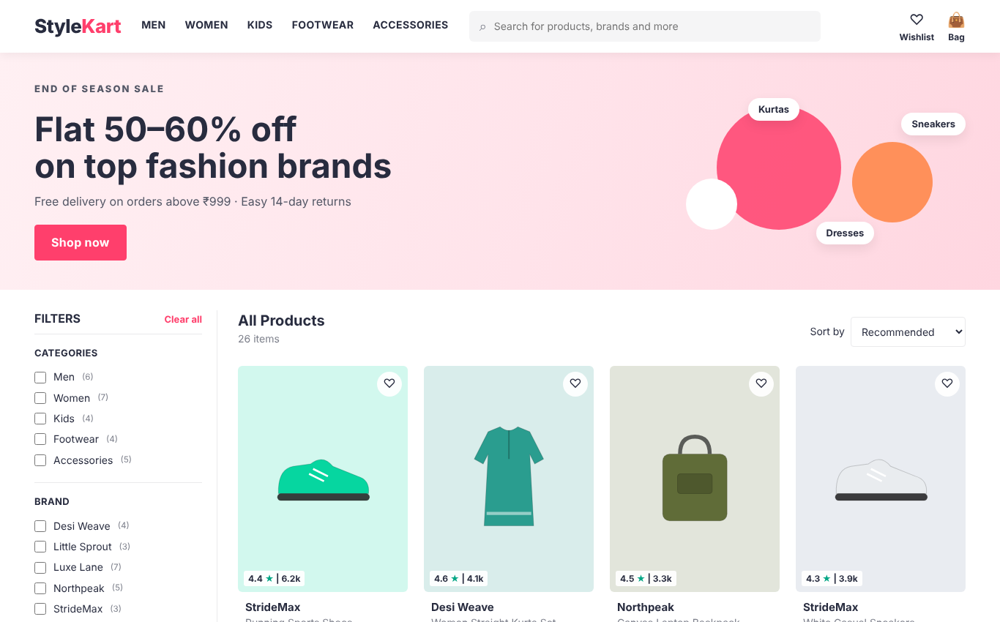
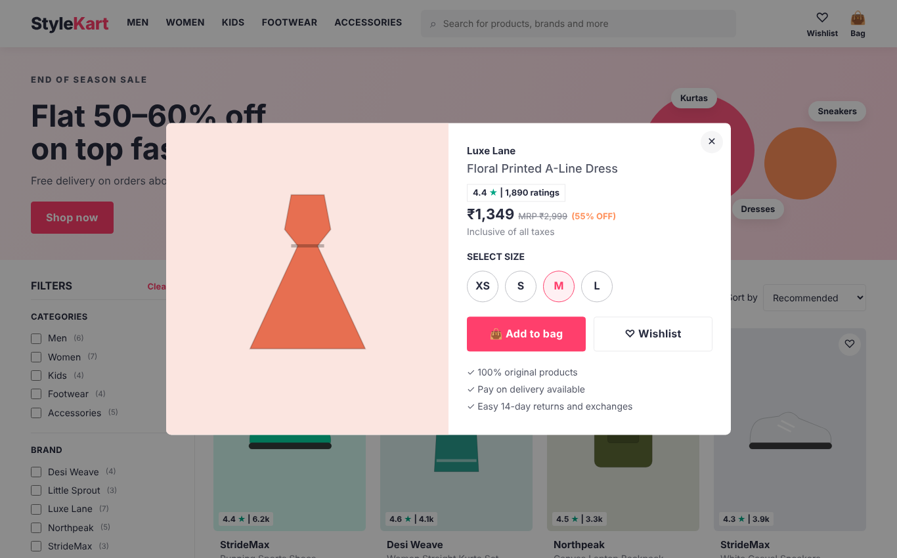
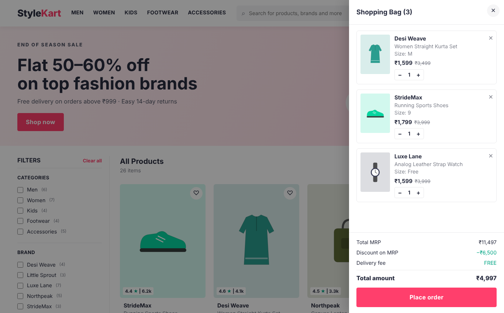

# StyleKart: Fashion E-Commerce Website



A responsive fashion e-commerce front end inspired by popular Indian online fashion stores. Built with plain **HTML, CSS and JavaScript**, with no frameworks and no image files: every product picture is an inline SVG.


**Live demo:** https://shubhamsharma1031.github.io/fashion-ecommerce-website/

## Screenshots

| Home page | Quick view | Shopping bag |
|---|---|---|
|  |  |  |

## Features

**Browsing**
- 26 products across Men, Women, Kids, Footwear and Accessories
- Live **search** across name, brand and category (debounced)
- **Filters**: category, brand (with counts), price slider, minimum discount, minimum rating
- **Active filter chips** that can be removed one by one, plus "Clear all"
- **Sorting**: recommended, what's new, price low→high / high→low, better discount, rating

**Product**
- **Quick view** modal with size selection and validation ("Please select a size")
- Price, MRP and discount percentage calculated automatically
- Ratings badge with review count

**Bag and wishlist**
- **Wishlist** (♡) with move-to-bag
- **Shopping bag** drawer: change quantity, remove items, same product in different sizes kept separately
- **Price summary**: total MRP, discount, delivery fee (free above ₹999, with "add ₹X more" hint), total
- Bag and wishlist are saved in `localStorage`, so they survive a page refresh
- Demo "Place order" flow

**Design**
- Fully responsive: slide-in filter panel and 2-column grid on mobile
- Keyboard support: Enter opens a product, Escape closes dialogs
- Indian currency formatting (`₹1,299`) with `toLocaleString("en-IN")`

## How it works

| File | Purpose |
|---|---|
| `js/products.js` | Product data (name, brand, category, price, MRP, rating, sizes, colour) |
| `js/app.js` | Filtering, sorting, rendering, quick view, bag and wishlist logic |
| `css/style.css` | Layout (CSS Grid + Flexbox), components, responsive breakpoints |

The app keeps one `state` object for filters. Every change calls `update()`, which re-renders filters, chips and products from that state, so the UI always matches the data. Filtering is one function (`matches`) that checks every active condition, and sorting uses a lookup table of compare functions.

## Run locally

Open `index.html` in a browser. No build step or server needed.

## Project structure

```
fashion-ecommerce-website/
├── index.html
├── css/style.css
└── js/
    ├── products.js
    └── app.js
```

## Note

Brand names and products are fictional and created for this project.

## Author

**Shubham Sharma** · [LinkedIn](https://www.linkedin.com/in/shubham-sharma-27aa38268) · [Portfolio](https://shubhamsharma1031.netlify.app/)
